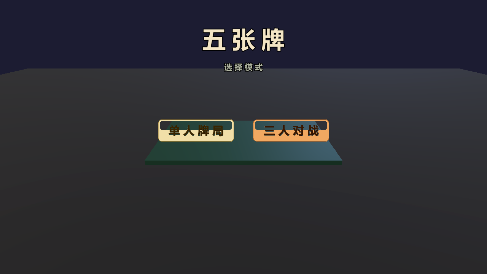
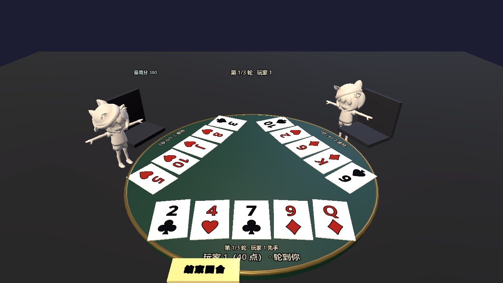
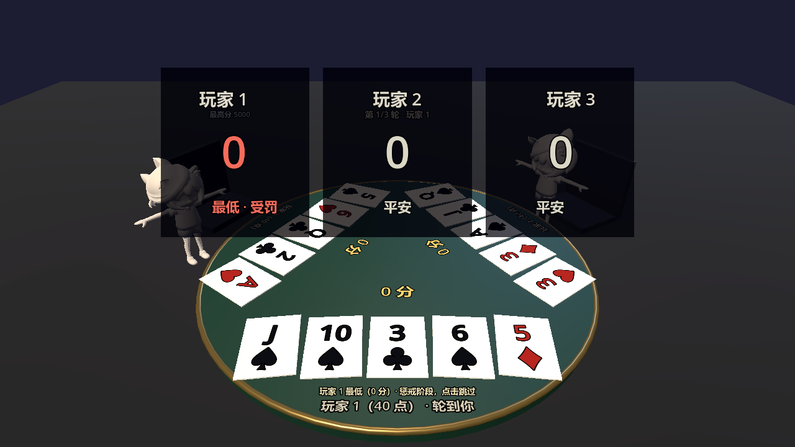
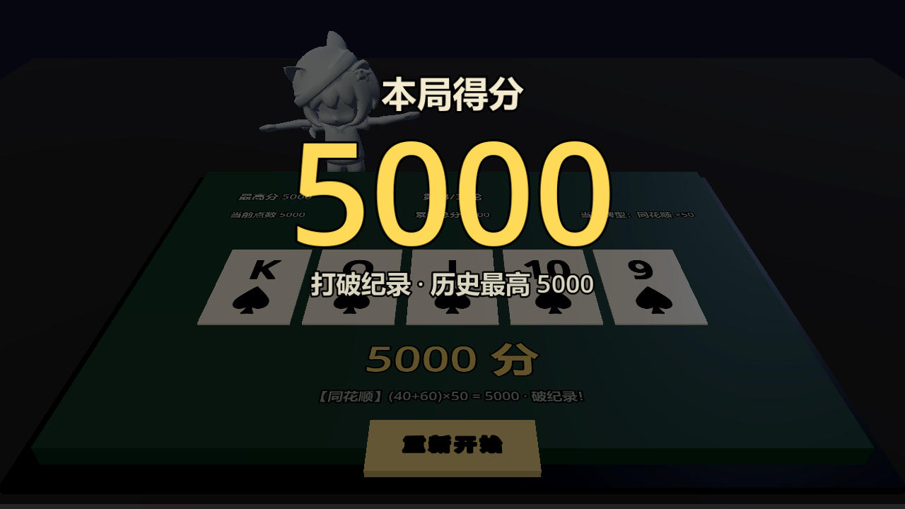

# 五张牌 · 3D（Godot 4.7）

> 一个用 Godot 4 从零搭起来的 3D 卡牌游戏原型：单人三轮换牌 + 三人围坐对战，
> 场景、动画、音效全部由代码生成，不依赖手写 .tscn 和外部素材。



| 三人桌面 | 结算展示 |
|---|---|
|  |  |



Flutter 版全部搬到这里了，一个工程两个模式：**单人牌局** / **圆桌三人对战**。
场景全部用代码搭（`scripts/*.gd`），不用手写 `.tscn`。

## 运行

```
D:\godot\Godot_v4.7.2-stable_win64.exe --path C:\Users\22818\StudioProjects\cards3d
```

也可以直接在 Godot 编辑器里打开这个目录按 F5。

命令行直进某个模式（调试用）：

```
... --path . -- --mode=single          单人
... --path . -- --mode=3p --seat=0     三人，并直接看向 0 号座位
```

## 结构

```
project.godot
main.tscn                 # 根节点 → root.gd
scripts\
  root.gd                 # 入口 / 模式选择菜单
  game_single.gd          # 单人：3 轮、换牌、结算
  game_3p.gd              # 三人：圆桌、镜头转到当前玩家
assets\
  model.fbx               # 猫耳小人（Tripo 导出，运行时用 FBXDocument 读取）
  model.glb               # 旧的压缩包，读不了，留作参考
```

## 规则（照 app1 搬的）

`scripts/poker.gd` 是唯一的规则来源，两个模式共用。

**牌**：一副 52 张，A=14 K=13 Q=12 J=11，其余按面值。

**牌型与倍率**：

| 牌型 | 倍率 |
|---|---|
| 同花顺 | 50 |
| 四条 | 25 |
| 葫芦 | 9 |
| 同花 | 6 |
| 顺子 | 4 |
| 三条 | 3 |
| 两对 | 2 |
| 对子（J 以上） | 1 |
| 一对小牌（J 以下） | 0 |
| 高牌 | 0 |

**结算**：`(底注 40 + 五张点数之和) × 倍率`

**三轮换牌 → 一次结算**：
- 第 1、2 轮只换牌，界面只有「下一轮」
- 第 3 轮才出现「结算本局」
- 进下一轮**不重新发牌**，只解锁换牌次数
- 结算只发生一次，算的是三轮折腾后的最终手牌

**惩罚**：结算后低于 100 分 → 惩戒过场。

**三人模式的流程**（和单人不同）：

- 一轮 = 三家**各走一个换牌回合**：轮到谁，谁换牌，点「结束回合」交给下一位
- 三家都结束后才进入下一轮，共三轮
- 三轮走完才一次性结算三家的分数，最低分低于 100 就进惩戒
- 先手每轮轮换：第 1 轮玩家 1、第 2 轮玩家 2、第 3 轮玩家 3

## 过场（Godot 原生）

`scripts/cutscene.gd` 是共用模块，两个模式都调用它：

```gdscript
const CutsceneKit = preload("res://scripts/cutscene.gd")
_play_cut(CutsceneKit.victory(self, "Cam"), "加冕")
_play_cut(CutsceneKit.punishment(self, "CamPivot/Cam"), "惩戒")
```

- **惩戒**：印章从天上砸到桌面 + 相机位移抖动 + 金色冲击波，4.4s，点击跳过
- **加冕**：金「新纪录」牌升起 + 金色粒子爆发 + 相对推镜，3.8s

两个过场在**单人**和**三人**里都能用：单人破纪录放加冕、低于 100 放惩戒；三人里有人刷新最高分放加冕、轮末最低分低于 100 放惩戒。

> 为什么不用原 HTML 过场：Godot 4 只支持 Ogg Theora（`VideoStreamTheora`），
> 带透明通道的 WebM/VP9 播不了。备选方案是逐帧 PNG 序列 + 贴图动画。

## 最高分存档

`scripts/score_store.gd` 用 `ConfigFile` 存到 `user://save.cfg`：

```
C:\Users\<你>\AppData\Roaming\Godot\app_userdata\五张牌 3D\save.cfg
```

```ini
[score]
best=375
```

- 只有更高才写盘（`set_best` 内部比较）
- 两个模式共用同一份纪录，启动时读出来显示在左上角
- 想清空：删掉这个文件，或者调 `ScoreStore.clear()`

## 待机动作（三人模式）

`_idle_hands()` 每帧跑，按玩家状态分三种表现：

| 状态 | 手牌 | 提示 |
|---|---|---|
| 轮到你 | 平铺、不动 | 名字高亮 |
| 干等着 | 每张轻微上下浮（相位错开） | — |
| 已结算 | 收成一摞（越上面的 y 越高） | 头顶浮「等待中」，上下轻晃 |

牌面文字（Label3D）跟着牌一起移动，收牌后只露出最上面那张。

先手每轮轮换：第 1 轮玩家 1、第 2 轮玩家 2、第 3 轮玩家 3，镜头也跟着转到对应座位。

## 已知待办

1. 角色是静态 T-pose，没有骨骼动画；待机是程序化的（浮动 / 呼吸 / 点头）
2. 菜单文字是浮在按钮上方的 Label3D（受光照影响），后续可以换成贴图按钮
3. 「等待中」是文字提示，还没有人物动作（挠头、抖腿之类）
4. 角色站在两个座位之间，某些镜头下会被裁掉一部分

## 自检

无头跑一遍，确认脚本和计分没问题：

```
... --headless --path .
```

## 菜单按钮（贴图）

按钮是 `Sprite3D` + 程序生成的 PNG（`assets/ui/btn_single.png` / `btn_multi.png`）：

- 640×200 圆角矩形，Pillow 生成，微软雅黑粗体
- 世界尺寸约 1.06 × 0.33（`pixel_size = 0.00165`）
- `billboard` 朝向相机，`shaded = false` 不受光照影响
- 鼠标靠近放大 8%（`_process` 里按屏幕距离判断）

重新生成按钮图：`python make_buttons.py`（脚本在 DSH 工作区，改完记得 `--import` 一次）。

> 新增贴图后必须跑一次：`Godot --headless --path . --import`，否则 Godot 找不到资源加载器。

## 过场音效

`assets/sfx/` 里三个 WAV，全部用 numpy 合成（`make_sfx.py`），没有版权素材：

| 文件 | 内容 |
|---|---|
| `sfx_fall.wav` | 下落风声：噪声 + 截止频率 5200→320Hz 下滑 |
| `sfx_hit.wav` | 砸击：58Hz 闷响 + 124Hz 体感 + 短促噪声 + 32Hz 下潜 |
| `sfx_victory.wav` | 加冕和弦：C-E-G-C 加高音闪烁，2 秒衰减 |

两条原则落在代码里：

**1. 留白换动态**
整局游戏是**静音**的，只有过场出声——对比本身就有效果。
过场内部还有第二次留白：惩戒前 0.35 秒完全不发声，印章悬停不动，然后风声才起。

**2. 声音和画面共用一个时间表**
`cutscene.gd` 顶部五个常量：

```gdscript
const PUNISH_HOLD := 0.35      # 悬停 + 静音
const PUNISH_IMPACT := 1.15    # 砸桌（画面/声音/震动/冲击波同一刻）
const VICTORY_POP := 0.55      # 金牌弹起（和弦在同一刻）
```

动画关键帧和音频排期都引用这些常量，改一个数两边一起变——
不会出现「声音对上了、抖动慢半拍」的问题。

实测日志：

```
[SFX] t=0.35s 播 sfx_fall.wav
[SFX] t=1.15s 播 sfx_hit.wav
[SFX] t=0.55s 播 sfx_victory.wav
```

## 三人模式的镜头与人物

**第一人称围坐**：镜头站在当前行动玩家座位后面，绕桌转到对应方向，
所以每一轮换先手时会有一次 0.65 秒的转场。

- 自己那家的角色**不显示**（第一人称，等于从自己眼睛看出去）
- 另外两家的人物都在各自座位上，站在椅子外侧、朝向桌心
- 三个角色动作不同步：浮动、压扁、左右晃、东张西望、耸肩、等人前倾、结算点头

**动作全部是整体的**（不是骨骼动画）。

> 关于骨骼：`model_rigged.fbx` 有 78 根骨骼、蒙皮绑定索引也对，但
> **骨骼姿态对网格没有任何影响**（三条轴各转 60°、转头 45°、换用编辑器导入的 .scn，
> 画面都像素级一致）。要真正的肢体动作，需要一份蒙皮正常的导出
> （Mixamo 绑骨导出 / 带动画的 GLB）。

## 界面音效

`scripts/sfx.gd` 是一次性播放器（每次 new 一个 `AudioStreamPlayer`，播完自毁）：

```gdscript
Sfx.play(self, "deal", -10.0)
```

| 键 | 什么时候响 | 素材 |
|---|---|---|
| `deal` | 发牌，每张错开 55–70ms | `sfx_deal.wav` 纸片落桌 |
| `flip` | 换牌 | `sfx_flip.wav` 沙沙声 |
| `click` | 点按钮 / 结束回合 | `sfx_click.wav` 双音短促 |
| `round` | 进入下一轮 | `sfx_round.wav` 两声上行 |
| `win` / `lose` | 结算达标 / 未达标 | 小上行 / 下行 |
| `fall` `hit` `victory` | 过场专用 | 见上面「过场音效」 |

全部用 numpy 合成，没有外部素材。新增贴图/音频后记得跑一次
`Godot --headless --path . --import`。

## 结算分数特写

惩戒 / 加冕之前先停一拍，把这一局的分数砸在屏幕中间（`CutsceneKit.closeup`）：

- 半透明背板（`QuadMesh` + 无光照透明材质，billboard）
- 数字从 0.25 倍弹出到 1.18 再回到 1.0，1.35 秒后放大淡出
- 上面一行标题（「本局得分」/「玩家 2 得分」），下面一行原因（「低于 100 分」/「打破纪录」）
- 镜头轻推 7%，配一声 `sfx_round`

**串场方式**：`_play_cut(容器, 名字, 下一个动作)`，特写播完自动接惩戒或加冕。

| 模式 | 触发 | 特写内容 |
|---|---|---|
| 单人 | 结算 < 100 | 「本局得分」+ 分数 + 「低于 100 分」，接惩戒 |
| 单人 | 破纪录 | 「本局得分」+ 分数 + 「打破纪录 · 历史最高 N」，接加冕 |
| 三人 | 轮末最低 < 100 | 「玩家 N 得分」+ 分数 + 「低于 100 分」，接惩戒 |

## 三人结算展示

三轮走完，先亮三块并排的分数牌（`CutsceneKit.score_board`），再进惩戒：

- 三块半透明面板依次弹出（0.25s / 0.57s / 0.89s），带一点回弹
- 每块写：玩家名、分数、标签
- 标签配色：**本局最高**（金）、**最低 · 受罚**（红）、平安（灰白）
- 整段 3 秒，播完自动接惩戒过场或「重新开始」

单人没有这块板——单人只有一个玩家，直接用分数特写。

## 菜单音效

- 进入菜单 0.35 秒后一声轻提示（`round`，-16dB）
- 鼠标划过按钮：极短的高频轻响（`hover`，-14dB），只在**进入**按钮时触发，不是每帧
- 点击进入模式：`click`（-6dB）

菜单没有背景音乐——保持安静，进游戏才出声，和过场的「留白换动态」一致。

## 手牌可见性（三人）

只有**正在行动**的那家能看到自己的牌面，另外两家显示**牌背**（暗红）。

- 换人时同时翻牌：前一家的手牌翻过去，下一家的翻出来
- 结算 / 惩戒阶段全部亮牌（摊牌）
- 自己那家的角色依旧隐藏（第一人称），对手角色可见

实现是 `_update_hand_visibility()`：按 `active` 切换每张牌的 `Label3D.visible`
和牌面材质，在开局、换人、结算三处刷新。

## 牌背与翻牌动画

牌背是程序画的图（`assets/ui/card_back.png`，384×540）：暗红底 + 菱形格 +
金色双边框 + 中央徽记。贴在每张牌上方 2cm 处的 `QuadMesh` 薄片上。

翻牌动画（`_flip_card`）：牌体绕短轴压扁到 0.05 倍（0.07s），
压到最扁的瞬间切换正反面，再弹回原状（0.10s），一共 0.17 秒。

触发点：

- 换牌（`_replace`）
- 轮到下一家（整手牌一起翻）
- 每轮开始 / 三轮摊牌

> 直接把纹理贴在牌的 `BoxMesh` 上会错位（六面的 UV 各占一块），
> 所以牌背单独用一块 `QuadMesh`，UV 干净。

## 随机性验证

洗牌与发牌的随机性有可复现的测试（`test_random.gd`）：

```
Godot --headless --path . --script res://test_random.gd
```

实测结果：

| 检查项 | 结果 |
|---|---|
| 200 次洗牌后牌是否完整、有无重复 | 0 次异常 |
| 首张牌点数分布（26000 次，卡方检验） | 卡方 11.3（12 自由度，0.01 临界值 26.2）→ 均匀 |
| 两次洗牌同位置的牌数 | 4 / 52（独立洗牌的正常重叠） |
| 两次 `randomize()` 的种子 | 不同 |
| 连续三次启动的首手牌 | 各不相同 |

实现要点：

- 洗牌是标准 Fisher–Yates，`randi_range(0, i)` 两端都含，无偏
- 每次开局 `build_deck()` 重新建 52 张再洗，不是复用一副旧牌
- 换牌从牌堆 `pop_back()`，同一局内不会出现重复牌
- `RandomNumberGenerator` 在 `_ready` 里 `randomize()`，种子来自系统时间
